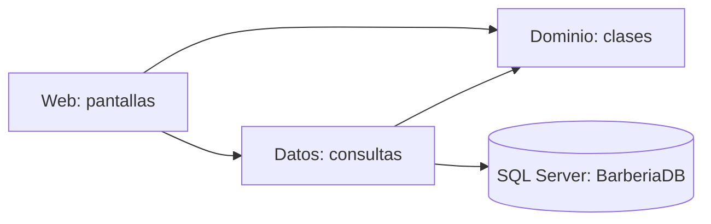
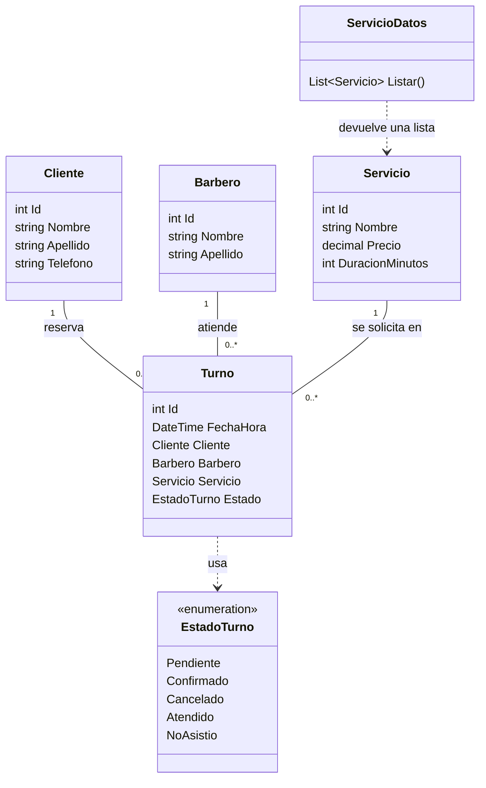

# Sistema de turnos para barbería

TP integrador. La idea es organizar los servicios, los clientes, los barberos y sus turnos. Lo vamos desarrollando según las etapas de la materia.

## Qué hicimos hasta ahora

- Creamos las clases Cliente, Barbero, Servicio y Turno y el enum EstadoTurno.
- Armamos Inicio, Servicios y Reservar turno, con un menú para navegar.
- Conectamos Servicios con SQL Server para mostrar los registros en una grilla.
- Armamos el formulario de reserva con servicio, barbero, fecha y horario de ejemplo. Todavía no guarda turnos y el botón de confirmar está deshabilitado.
- Agregamos el script para preparar la base en cada equipo.

Probamos la navegación y la lectura de servicios en la computadora donde integramos el trabajo. Falta que cada integrante lo pruebe en la suya.

Los ABM, las reservas reales y el inicio de sesión quedan para las próximas etapas. Por ahora todos los barberos realizan los mismos servicios.

## Organización del proyecto

Abrimos **Barberia.sln**, en la raíz. La solución tiene tres proyectos para .NET Framework 4.8:

| Proyecto | Para qué lo usamos |
| --- | --- |
| Dominio | Contiene las clases del negocio. |
| Datos | Consulta SQL Server y devuelve objetos del dominio. |
| Web | Contiene las pantallas de Web Forms y el menú compartido en Site.Master. |



Las flechas entre proyectos representan referencias. No copiamos las clases dentro de Web: usamos las de Dominio y Datos.

## Clases y relaciones



Un cliente puede tener varios turnos, lo mismo que un barbero. Un servicio puede aparecer en muchas reservas. Cada turno tiene un solo cliente, barbero y servicio. `0..*` significa ninguno, uno o muchos.

EstadoTurno es una lista de opciones, no una entidad. Cada turno comienza en Pendiente; las reglas de cambio de estado todavía no están implementadas.

HorarioTrabajo se conversó para ampliar el diseño, pero todavía no tiene una clase en el código. En **Relaciones - App de Barberia.html** está marcado como propuesto.

## Cómo leemos los servicios

Servicios.aspx llama a ServicioDatos.Listar() desde Page_Load. El método abre la conexión y ejecuta el SELECT. Por cada fila crea un Servicio y lo agrega a una lista. La pantalla recibe esa lista y la muestra en el GridView.

## Cómo ejecutarlo en cada computadora

### 1. Herramientas

Usar Visual Studio Community 2022 o posterior, con soporte para C# 10. En Visual Studio Installer deben estar las herramientas de **ASP.NET y desarrollo web** y las herramientas de destino de **.NET Framework 4.8**. Para la base usamos SQL Server y Management Studio.

### 2. Traer los cambios

La rama compartida es **auxiliar**. Guarden y hagan commit de su trabajo antes de cambiar de rama. Hagan Fetch/Obtener, cambien a auxiliar y hagan Pull. Si recién clonan el repositorio, elijan esa rama.

Cierren la solución anterior y abran **Barberia.sln** desde la raíz. Deben aparecer Dominio, Datos y Web.

### 3. Preparar la base

En Management Studio, conéctense a su servidor, abran **BaseDeDatos/BarberiaDB.sql** y ejecuten el archivo completo.

Crea BarberiaDB y la tabla Servicios si no existen. Carga ejemplos solamente si la tabla está vacía y no borra registros. La base no se descarga con Git: hay que prepararla en cada computadora.

### 4. Configurar la conexión

En **Web/Web.config** está:

```xml
<add name="BarberiaDB"
     connectionString="Server=.\SQLEXPRESS;Database=BarberiaDB;Integrated Security=True;"
     providerName="System.Data.SqlClient" />
```

`.\SQLEXPRESS` apunta a la instancia SQLEXPRESS local. Si usan otro servidor, reemplacen ese valor por el nombre que figura en Management Studio. Integrated Security usa la cuenta de Windows que ejecuta la aplicación.

Si cambian el servidor para su equipo, revisen ese cambio antes del commit para no subir un nombre personal como configuración de todos.

### 5. Compilar y probar

1. Clic derecho sobre **Web → Establecer como proyecto de inicio**.
2. **Compilar → Recompilar solución**.
3. Ejecutar con F5.
4. Entrar a Servicios y comprobar que se vean los registros de la base.
5. Recorrer Inicio, Reservar turno y el enlace para volver a Servicios.

Dominio y Datos son bibliotecas: no se ejecutan directamente. Si aparece ese aviso, revisen que Web sea el proyecto de inicio.

Compilar verifica el código. Para ver los servicios también tiene que estar disponible SQL Server y funcionar la conexión.

## Para trabajar en equipo

Antes de empezar, traer los cambios de auxiliar. Antes de subir, guardar, compilar y revisar qué archivos entran al commit.

Las carpetas .vs, bin y obj están ignoradas porque son archivos locales o generados. Si hay conflictos al hacer Pull, revisarlos juntos antes de descartar cambios.
